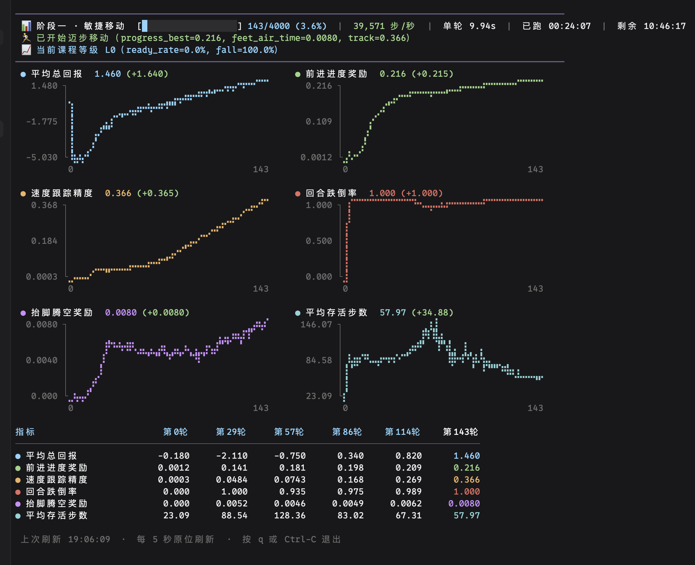
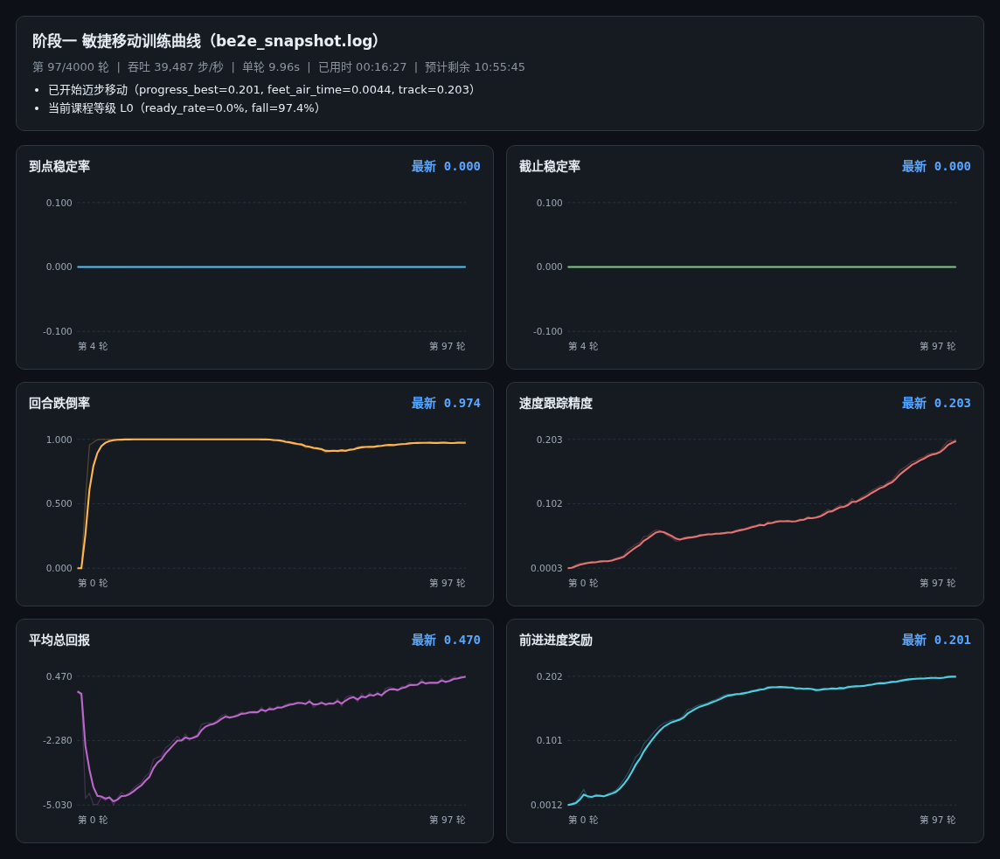

# curve_it

`curve_it` 读取 RSL-RL 的文本训练日志，在终端显示曲线和最新指标，可导出独立 HTML 或 PNG。目录模式默认挑选最新的 `be2e_*.log`。安装和图表导出可在独立的工具目录完成，工具以只读方式打开训练日志。

## 安装

需要 Python 3.10 或以上。终端图和 HTML 使用 Python 标准库。要启用 PNG 导出，将最后一条命令的 `-e .` 换成 `-e '.[png]'`。

```bash
cd /personal_fast_storage/curve_it
uv venv .venv
uv pip install --python .venv/bin/python -e .
```

## 推荐用法是在 tty7 单独开一个监看窗口

在自己的 `tty7` 窗口里运行 `curve_it`，让训练继续在原来的进程或终端里跑。给工具传训练日志目录，它会在启动时选中最新的 `be2e_*.log`，每 5 秒更新曲线。下面这条命令可以在任意目录执行。

```bash
/personal_fast_storage/curve_it/.venv/bin/curve_it \
  /personal_fast_storage/BadmintonLab-Game/logs/console --watch 5
```

按 `q` 或 `Ctrl+C` 退出。训练换到新日志后，重新打开监看窗口即可选中新日志。如果 `tty7` 指本机 Linux 虚拟控制台，可以用 `tty` 确认设备名。Ubuntu 桌面通常可用 `Ctrl+Alt+F7` 切换，具体取决于系统配置。远程机器上也可以在 SSH 或已有的 tmux 窗口里执行同一条命令。



上图是在 `tty7` 中查看 BE2E 步法训练第 143 轮的实录。六张曲线显示训练走势，下方的表格方便对照不同轮次的指标。在 Linux 虚拟控制台上会自动使用 ASCII，也可用 `--ascii` 手动切换。`--no-color` 可以关闭颜色。

## 使用场景

| 你在做什么 | 用法 |
| --- | --- |
| 训练时随时看进展 | 给出日志目录，添加 `--watch 5`。 |
| 只核对几条曲线 | 用 `--list` 查指标名，再用 `--metrics` 选择所需指标。 |
| 复盘某一次训练或分享结果 | 给出具体日志文件，使用 `--html` 导出单页，或使用 `--png` 导出图像。 |

在工具目录里可以运行下面的命令。`LOG` 也可以换成某次训练的 `.log` 文件。遇到不同的日志命名规则时，可用 `--pattern '*.log'`。

```bash
LOG=/personal_fast_storage/BadmintonLab-Game/logs/console
.venv/bin/curve_it "$LOG" --list
.venv/bin/curve_it "$LOG" --metrics 'Mean reward,Episode_Termination/fall,Loco/ready_rate'
.venv/bin/curve_it "$LOG" --html outputs/training.html
.venv/bin/curve_it "$LOG" --png outputs/training.png
```



上图是浏览器打开 HTML 导出的实际截屏。横轴是训练轮次，缺失指标显示 `--` 或「暂无数据」。终端默认显示原始值，`--term-smooth 0.6` 启用指数移动平均。HTML 和 PNG 保留原始曲线，`--smooth 0` 可关闭平滑。省略导出路径时，文件保存到当前工作目录。HTML 可离线打开。

## 怎么看训练表现

| 指标 | 看法 |
| --- | --- |
| `Mean reward` | 看同一运行中的总体趋势。奖励定义或课程变动后，结合任务指标一起读。 |
| `Episode_Termination/fall` | 训练回合的跌倒比例，越低越好。`0.05` 表示约 5%。 |
| `Loco/ready_rate`、`Loco/deadline_stable_rate` | 前者表示截止前曾经到位并稳住，后者表示截止时仍稳定。结合两者可看出机器人是否到得了、停得住。 |
| `Loco/track_kernel` | 速度跟踪的相似度，越接近 1 越好。关注它是否随前进进度一起提高。 |
| `Hit/contact_rate`、`Hit/legal_return_rate` | 触球与合法回球的比例。看两条曲线的差距，可定位是否经常碰到球但未合法回球。 |
| `Mean mean_kl loss` 或 `mean_kl` | 策略更新幅度。突然升高时，结合跌倒率和独立评测判断训练是否退化。 |

这些曲线来自训练日志。S1b 到位、正式回球与多拍成绩使用训练仓库的独立评测结果。

## 实现与验证

`log.py` 读取 `Learning iteration i/n` 和 `key: value` 行。`metrics.py` 提供默认指标及中文标签，`terminal.py` 绘制终端图，`export.py` 处理 HTML/PNG，`cli.py` 管理输入、刷新和退出。刷新时重读文本文件，可适应日志截短或重新打开。图表依赖记录中已有的数值，工具不会启动模拟器。

```bash
uv pip install --python .venv/bin/python -e '.[dev,png]'
.venv/bin/python -m pytest -q
.venv/bin/ruff check src tests
```
